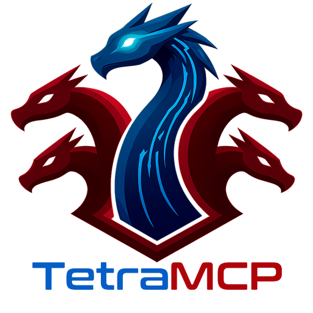

[](https://www.apache.org/licenses/LICENSE-2.0)
[](https://github.com/kronflux/TetraMCP/releases)
[](https://github.com/kronflux/TetraMCP/stargazers)
[](https://github.com/kronflux/TetraMCP/network/members)
[](https://github.com/kronflux/TetraMCP/graphs/contributors)


# TetraMCP for Ghidra

TetraMCP is a [Model Context Protocol](https://modelcontextprotocol.io/) (MCP)
server embedded in [Ghidra](https://ghidra-sre.org/). It gives an MCP-capable AI
client direct access to Ghidra's analysis, so the client works on a binary
through the same APIs the user interface does.

Ghidra presents a binary through three perspectives: hex, disassembly and
debugging. TetraMCP adds a fourth, an LLM cognition layer served over MCP, as a
single extension with no bridge script and no second process.

<p align="center">

</p>

## Contents

- [Overview](#overview)
- [Features](#features)
- [Requirements](#requirements)
- [Installation](#installation)
- [Client setup](#client-setup)
- [Configuration](#configuration)
- [Tool reference](#tool-reference)
- [Architecture](#architecture)
- [Building from source](#building-from-source)
- [Changelog](#changelog)
- [License](#license)

## Overview

- **Native MCP server.** An embedded Jetty server speaks Streamable HTTP from
  inside the Ghidra JVM. No Python bridge and no external process take part, so
  a tool call reaches Ghidra's API without a serialisation boundary.
- **Broad tool surface.** Over 140 tools in 29 namespaces, covering
  decompilation, memory and data, control and data flow, emulation,
  cryptographic constant detection, patching and external tooling.
- **Optional AI layer.** With a provider configured, the server can explain a
  function, comment decompiled code and propose names, using the analysis
  context it already holds.
- **Several programs at once.** Each open program keeps its own state, so an
  agent can work across binaries in one session.
- **Multi-agent support.** Findings and a task queue are shared per program, so
  two agents working one binary read each other's results.

## Features

### Program analysis

- Decompilation to C and assembly listings, both paginated so a large function
  answers within a client's message budget.
- Control flow and call graphs.
- Forward and backward data flow tracing over p-code SSA.
- Cross-references to and from addresses, functions and data.

### AI-assisted analysis

- Name suggestions for functions and variables, derived from the surrounding
  code.
- Function summaries, saved as plate comments.
- Line-by-line annotation of decompiled output.
- Function names recovered from the format strings a binary passes to its own
  logging calls.

### Tooling

- Cryptographic constant detection against an embedded signature database, such
  as the AES S-box and the SHA initialisation vectors.
- P-code emulation: step execution, inspect registers, modify memory.
- `binwalk`, YARA and Go binary analysis driven as child processes.
- Cython and CPython structure recovery, including the interpreter version a
  module was built against.
- Library function identification through Ghidra's FunctionID, documented in
  [docs/FunctionID.md](docs/FunctionID.md).
- Long analyses run as background jobs that report progress and can be
  cancelled.

## Requirements

| To | You need |
|---|---|
| Run a published release | Ghidra, plus the JDK that Ghidra release requires. Take the TetraMCP release whose name matches your Ghidra version: Ghidra refuses an extension built for a different release. |
| Build from source | A Ghidra installation and the JDK named by `application.java.compiler` in its `Ghidra/application.properties`. That is 21 for Ghidra 12.1.2 and earlier, and 25 for Ghidra 12.2. |

## Installation

1. Download the release ZIP for your Ghidra version from the
   [Releases](https://github.com/kronflux/TetraMCP/releases) page, or build from
   source as described below.
2. Start Ghidra and select `File` -> `Install Extensions`.
3. Click `+`, select the ZIP, and restart Ghidra.
4. Open a binary in CodeBrowser.
5. Select `File` -> `Configure` -> `Developer` and enable **TetraMcpPlugin**.

`TetraMcpPlugin` is the only plugin to enable. There is no companion plugin:
TetraMCP learns that a program has closed from Ghidra itself, by subscribing to
that program's own close notification, so releasing its cached decompilations
and native decompiler processes does not depend on a second plugin being on.

The server starts automatically on `http://localhost:18489/mcp`. The host and
port are tool options, described under [Configuration](#configuration).

## Client setup

Any MCP client that supports Streamable HTTP transport can connect.

### Claude Desktop

Add the server to `claude_desktop_config.json`, which lives at
`~/Library/Application Support/Claude/claude_desktop_config.json` on macOS and
`%APPDATA%\Claude\claude_desktop_config.json` on Windows:

```json
{
  "mcpServers": {
    "tetramcp": {
      "type": "http",
      "url": "http://localhost:18489/mcp"
    }
  }
}
```

### Claude Code

```bash
claude mcp add tetramcp --transport http http://localhost:18489/mcp
```

### Cursor

Create or edit `.cursor/mcp.json` in the project root:

```json
{
  "mcpServers": {
    "tetramcp": {
      "url": "http://localhost:18489/mcp"
    }
  }
}
```

## Configuration

Settings live in Ghidra under `Edit` -> `Tool Options`.

### Server (TetraMCP)

| Setting | Default | Description |
|---|---|---|
| Server Host | `127.0.0.1` | Bind address |
| Server Port | `18489` | HTTP port |

### AI (TetraMCP.AI)

| Setting | Default | Description |
|---|---|---|
| AI Enabled | `false` | Enable AI-assisted analysis |
| AI Provider | `anthropic` | `anthropic` or `openai` |
| AI Model | `claude-sonnet-4-6` | Model name |

For a local model through Ollama, set the provider to `openai`, the API URL to
`http://localhost:11434/v1/chat/completions`, the model to your model's name,
and leave the API key empty.

## Tool reference

The authoritative list is what the server answers to `tools/list`; a client
shows it on connection. The namespaces are `agents`, `ai`, `analysis`, `batch`,
`bookmarks`, `classes`, `comments`, `constants`, `crypto`, `cython`, `data`,
`datatypes`, `emulation`, `equates`, `fid`, `function`, `functions`,
`instances`, `jobs`, `memory`, `namespaces`, `program`, `project`, `scripts`,
`structs`, `symbols`, `ui`, `variables` and `xrefs`.

A selection, to show the shape:

| Tool | Answers |
|---|---|
| `program_info` | Program metadata: name, architecture, compiler, hashes |
| `instances_list`, `instances_use` | List open programs, switch the active one |
| `functions_decompile` | Decompiled C for one function, paginated |
| `functions_disassemble` | Assembly listing for one function, paginated |
| `functions_rename` | Rename a function |
| `memory_read` | Hex dump with ASCII |
| `memory_search_bytes` | Byte pattern search, wildcards allowed |
| `data_list_strings` | Strings, filtered by regular expression |
| `structs_create`, `structs_update_field` | Define and amend data structures |
| `analysis_callgraph`, `analysis_cfg` | Call graph, control flow graph |
| `xrefs_to`, `xrefs_from` | References to and from an address |
| `crypto_scan` | Known cryptographic constants in the program |
| `emulation_create`, `emulation_step`, `emulation_get_state` | Drive and inspect a p-code emulator |
| `fid_identify` | Match functions against attached FunctionID databases |
| `ai_explain_function`, `ai_suggest_renames` | LLM explanation and name proposals |
| `agents_add_finding`, `agents_get_next_task` | Record a finding, claim queued work |
| `jobs_list`, `jobs_result`, `jobs_cancel` | Observe and control background jobs |

### Example exchange

A client asked to find and explain an entry point, then check for cryptographic
constants, makes a sequence of calls like this:

```
functions_list    filter "main"          -> main at 0x00401000
functions_decompile  main                -> decompiled body
ai_explain_function  main                -> summary, saved as a plate comment
crypto_scan                              -> AES S-box at 0x00402000
                                            SHA-256 IV at 0x00402100
xrefs_to  0x00402000                     -> encrypt_data, decrypt_data
```

## Architecture

TetraMCP is one Java codebase running inside the Ghidra JVM.

```
MCP client (Claude, Cursor, ...)
    |  Streamable HTTP on :18489/mcp
Jetty 12, embedded
    |
MCP Java SDK
    |
Tool providers
    |
Ghidra APIs (FlatProgramAPI, DecompInterface, ...)
```

Tool calls run on a bounded pool TetraMCP owns, and writes to one program are
serialised by that program's own lock. Long work is handed to the job executor,
which reports progress on the session that started it.

### Adding tools from another extension

Implement `TetraMcpModule` and register it through Java's `ServiceLoader`. The
server holds a module's tools to the same rules as its own: names must not
collide, schemas must be ones the MCP server accepts, and a throw from a module
costs that module rather than the server.

```java
public class MyModule implements TetraMcpModule {
    public String getName() {
        return "MyTools";
    }

    public List<ToolSpecification> getToolSpecifications(McpServerManager manager) {
        // Return the tool definitions this module adds.
    }
}
```

## Building from source

The build takes its Java compile level, its Gradle version and its dependency
versions from the Ghidra release that is installed, so there is nothing to pin
by hand. Point `GHIDRA_INSTALL_DIR` at that installation:

```bash
export GHIDRA_INSTALL_DIR=/path/to/ghidra
./gradlew buildExtension
```

The extension ZIP is written to `dist/`.

The source calls the FunctionID and task monitor APIs as Ghidra 12.2 declares
them, and those signatures differ in Ghidra 12.1.2 and earlier. To build for an
older Ghidra, check out the `ghidra-<version>` tag that names it, or take that
version's release artifact.

### Checks

| Command | Covers |
|---|---|
| `./gradlew test` | Unit tests; no Ghidra installation needed at run time |
| `./gradlew integrationTest` | The server and its tools against a real Ghidra installation; needs a display, so use `xvfb-run` on a headless machine |
| `./gradlew verifyPackaging` | That the built ZIP carries the runtime artifacts and nothing else |

## Changelog

[CHANGELOG.md](CHANGELOG.md) records what changed, in a section per Ghidra
release, with a link to that Ghidra release's own notes.

## License

Apache License 2.0. See [LICENSE](LICENSE) for the full text.

## Acknowledgments

- [Ghidra](https://ghidra-sre.org/) by the National Security Agency
- The [Model Context Protocol](https://modelcontextprotocol.io/) specification
- The [MCP Java SDK](https://github.com/modelcontextprotocol/java-sdk)
